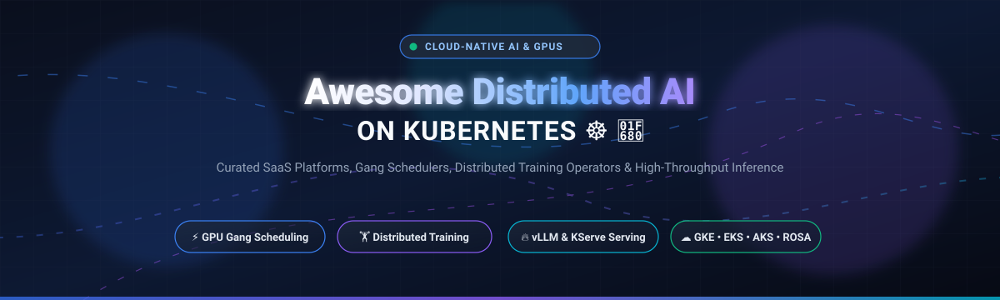
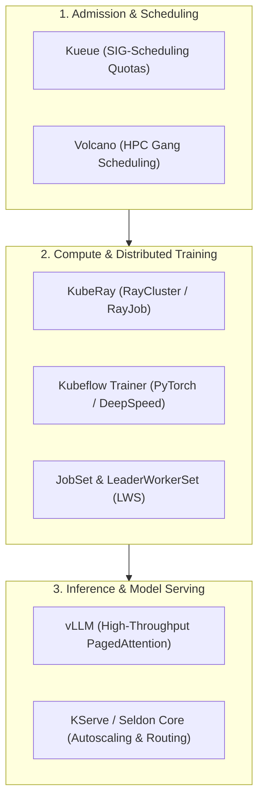
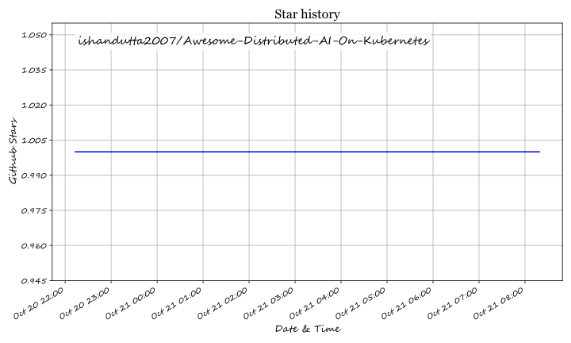

# ☸️ Awesome Distributed AI on Kubernetes 🤖⚡

**The definitive, production-grade curated index of cloud-native AI platforms, GPU gang schedulers, distributed training frameworks, and high-throughput LLM serving engines.**

  
  
  
  
  
  
  

*Curated list of SaaS products, managed cloud orchestrators, and open-source GitHub projects for multi-node GPU clusters, LLMs, and distributed MLOps.*

**Last updated: October 2026** 📅

---

## 📌 Table of Contents

- [🌐 Sector Overview & Market Dynamics](#-sector-overview--market-dynamics)
- [☁️ SaaS & Hosted Platforms](#️-saashosted-platforms)
- [🚀 Open-Source GitHub Projects](#-open-source-github-projects)
- [💡 Architectural Guide & Scheduler Selection](#-architectural-guide--scheduler-selection)
- [🤝 How to Contribute](#-how-to-contribute)
- [💖 Support & Sponsorship](#-support--sponsorship)
- [📈 Star History](#-star-history)
- [⚠️ Disclaimer](#️-disclaimer)

---

## 🌐 Sector Overview & Market Dynamics

The enterprise Kubernetes market is valued at **$2.5B–$3.1B** with the dedicated cloud-native AI/GPU infrastructure sub-segment accelerating past 25% CAGR toward a projected **$25B+ market size by the 2030s**, as over 68% of enterprise container environments now orchestrate distributed LLM training, fine-tuning, and inference on Kubernetes clusters. 

The sector exhibits a **barbell market structure**: the base infrastructure layer is **highly concentrated** around major cloud hyperscalers (GKE, AKS, EKS) controlling global GPU allocations, while the overlying software layer—spanning gang scheduling, distributed training operators, MLOps control planes, and serving runtimes—remains **heavily fragmented** among specialized CNCF open-source projects and high-growth tooling startups.

---

## ☁️ SaaS & Hosted Platforms

Managed cloud services that abstract cluster control planes, auto-scale GPU node pools, and deliver pre-configured MLOps stacks. Sorted in descending order of parent company market capitalization and enterprise valuation:

| Platform | Company Valuation / Market Cap | Pricing (Starting Tier) | Free Tier / Trial Limits | Description | Best For |
| :--- | :--- | :--- | :--- | :--- | :--- |
| **Google GKE** 🔷 | ~$4.1T (Alphabet Market Cap) | $0.10/cluster/hour (approx. $74.40/month standard control plane fee; compute billed separately) | **$74.40/month recurring credits** per billing account (covers 100% of 1 zonal Standard or Autopilot cluster control plane) + $300 90-day GCP new account trial credits | **Google Kubernetes Engine** with **GKE Autopilot** for fully managed nodes. Features **GKE Dataplane V2** (Cilium-based), **Node Auto-Provisioning**, and **GKE Sandbox** (gVisor) for workload isolation. | Teams on GCP wanting managed Kubernetes with integrated AI/ML tooling. |
| **Azure AKS** 🔷 | ~$3.9T (Microsoft Market Cap) | $0.00/hour for Free cluster management tier; Standard tier starts at $0.10/cluster/hour (approx. $73/month with 99.9% uptime SLA) | **Free Forever Tier**: $0/hour control plane for clusters up to 1,000 nodes (best-effort SLA; compute billed separately) + $200 30-day Azure trial credits | **Azure Kubernetes Service** with **Kueue integration** for Ray AI workloads. Features **GPU node pools**, **Workload Identity** for credential-free access to Azure Blob Storage, and **Terraform/Helm** provisioning. | Teams on Azure wanting managed Kubernetes with Ray and Kueue for distributed AI. |
| **AWS EKS** 🟧 | ~$2.8T (Amazon Market Cap) | $0.10/cluster/hour (approx. $73/month per standard cluster control plane; compute/EC2 billed separately) | **No permanent free control plane tier**; new AWS accounts receive a 6-month trial plan with **$100 sign-up credits** (up to $200 via console onboarding tasks) applicable toward EKS & EC2 compute | **Amazon Elastic Kubernetes Service** with **managed node groups**, **Fargate** for serverless pods, and **EKS Anywhere** for hybrid. **The AWS-native choice**—integrates with IAM, VPC, CloudWatch, and **EFA** for multi-node GPU communication. | Teams on AWS running distributed training with FSx for Lustre and EFA. |
| **Databricks** 🧱 | ~$134B (Private Valuation) | $0.07/DBU (Genie/Light) to $0.15–$0.20/DBU for Standard Data Engineering Jobs; compute billed separately | **Free Edition (Forever Free)**: Non-commercial personal tier with daily fair-use quotas, 1 serverless SQL warehouse (2X-Small), and max 5 concurrent jobs. **Business Free Trial**: 14 days with **$400 in usage credits** | **Managed lakehouse platform** with **managed Kubernetes** under the hood. Features **MLflow integration**, **Delta Lake**, and **Unity Catalog** governance. | Teams wanting managed infrastructure without Kubernetes operational burden. |
| **Red Hat OpenShift** 🎩 | ~$34B (IBM Acquisition Valuation; IBM Market Cap ~$225B) | $0.171/hour per 4 vCPUs (ROSA on-demand service fee) or $0.09/hour per 4 vCPUs (ROSA Hosted Control Plane) + infrastructure costs | **Developer Sandbox (30-day free environment, renewable)**: Up to 3 vCPU cores, 14 GB RAM, and 40 GB persistent storage. **Self-Managed 60-day free product trial** (user covers underlying cloud infrastructure) | **Enterprise Kubernetes platform** with **OpenShift AI** (built on Kubeflow) for ML workloads. Features **built-in CI/CD**, **security policies**, and **Operator Lifecycle Manager**. | Enterprises needing compliance-heavy Kubernetes with integrated MLOps. |

---

## 🚀 Open-Source GitHub Projects

Self-hosted, transparent, vendor-independent frameworks for gang scheduling, distributed training, batch orchestration, and open LLM inference on Kubernetes.

*Ranked and sorted strictly in descending order by GitHub_Stars:* ⭐

| Project | GitHub_Stars | Category | Key Highlights & Description | Primary Use Case |
| :--- | :---: | :--- | :--- | :--- |
| **[vLLM](https://github.com/vllm-project/vllm)** |  | LLM Inference & Serving | High-throughput, memory-efficient LLM serving engine featuring **PagedAttention**, continuous batching, chunked prefill, and native multi-node tensor-parallel serving on Kubernetes. | High-throughput production LLM model inference & serving |
| **[Argo Workflows](https://github.com/argoproj/argo-workflows)** |  | Workflow Orchestration | CNCF graduated container-native workflow engine. Orchestrates complex Directed Acyclic Graphs (DAGs) and step-based pipelines with parallel execution, artifact tracking, and retry-from-failure. | Pipeline-heavy ML workflows, ETL, and automated training runs |
| **[Kubeflow](https://github.com/kubeflow/kubeflow)** |  | Complete MLOps Platform | The CNCF incubating, industry-standard machine learning toolkit for Kubernetes. Provides unified dashboard, interactive notebooks, pipeline orchestration, hyperparameter tuning, and end-to-end model governance. | Enterprise multi-tenant MLOps platforms on Kubernetes clusters |
| **[Llama Stack](https://github.com/meta-llama/llama-stack)** |  | Agentic AI & Inference | Standardized building blocks, APIs, and containerized runtime distributions for building agentic AI, RAG pipelines, evaluations, and fine-tuning across Kubernetes nodes. | Standardized enterprise LLM and agent application deployments |
| **[Flyte](https://github.com/flyteorg/flyte)** |  | Workflow Orchestration | Structured, strongly typed, Python-native workflow engine with built-in data caching, distributed map tasks, and native Ray integration for mission-critical ML pipelines. | Teams wanting durable, reproducible workflows with Ray execution |
| **[KServe](https://github.com/kserve/kserve)** |  | Serverless Model Serving | Standardized, serverless model inference platform on Kubernetes. Provides autoscaling to zero, canary rollouts, multi-node inference via **LeaderWorkerSet (LWS)**, and confidential computing. | Scalable, multi-framework model serving & LLM production deployments |
| **[Volcano](https://github.com/volcano-sh/volcano)** |  | Batch & Gang Scheduling | CNCF incubating batch scheduler extending kube-scheduler with HPC-grade **gang scheduling, fair-share scheduling, priority preemption, task backfilling, and NUMA-aware topology scheduling**. | Heavy distributed training clusters transitioning from Slurm/HPC |
| **[Seldon Core](https://github.com/SeldonIO/seldon-core)** |  | Model Serving & Graphs | Kubernetes-native model serving framework supporting complex multi-step inference graphs, drift detection, explainability, payload logging, and multi-model GPU pooling. | Advanced inference pipelines with telemetry and observability |
| **[Kubeflow Pipelines](https://github.com/kubeflow/pipelines)** |  | ML Pipelines | Platform for building and deploying portable, reproducible machine learning workflows based on Docker containers, complete with artifact lineage tracking and interactive UI. | Reproducible ML experiments, data pipelines, and scheduled training runs |
| **[NVIDIA K8s Device Plugin](https://github.com/NVIDIA/k8s-device-plugin)** |  | Hardware Acceleration | Official DaemonSet allowing Kubernetes pods to consume NVIDIA GPUs, enabling Multi-Instance GPU (MIG), GPU time-slicing, and telemetry reporting to the cluster. | Foundational hardware enablement for all GPU-based Kubernetes clusters |
| **[Kueue](https://github.com/kubernetes-sigs/kueue)** |  | Job Queueing & Quota | Kubernetes-native job queueing controller managed by SIG-Scheduling. Implements all-or-nothing **gang admission**, dynamic quota borrowing across teams, and seamless integration with Karpenter. | Modern cloud-native default for GPU quota management and fair sharing |
| **[KubeRay](https://github.com/ray-project/kuberay)** |  | Distributed Compute | Official Kubernetes operator for Ray. Manages RayCluster (elastic lifecycle), RayJob (batch execution), and RayService (zero-downtime Ray Serve rollouts) with Kueue integration. | Ray-native distributed training, RLlib, and high-performance Python compute |
| **[Kubeflow Trainer](https://github.com/kubeflow/trainer)** |  | Distributed Training | Framework-agnostic Kubernetes training operator supporting PyTorch (`PyTorchJob`), TensorFlow (`TFJob`), Hugging Face, DeepSpeed, JAX, XGBoost, and MPI with a unified Python SDK. | Multi-team training clusters running diverse AI frameworks |
| **[Katib](https://github.com/kubeflow/katib)** |  | AutoML & Hyperparameter | Kubernetes-native system for automated machine learning (AutoML), hyperparameter tuning, neural architecture search (NAS), and early stopping algorithms across distributed workers. | Automated hyperparameter optimization on distributed clusters |
| **[Apache YuniKorn](https://github.com/apache/yunikorn-core)** |  | Multi-Tenant Scheduling | Apache top-level light-weight universal resource scheduler designed for large-scale multi-tenant distributed compute, supporting hierarchical queues, gang scheduling, and bin-packing. | Big data and AI hybrid multi-tenant scheduling at enterprise scale |
| **[LeaderWorkerSet (LWS)](https://github.com/kubernetes-sigs/lws)** |  | Multi-Node Pod Grouping | Official Kubernetes SIG-Apps API for deploying groups of pods where a leader pod coordinates one or more worker pods with co-scheduling, failure boundaries, and rolling updates. | Multi-node distributed inference (e.g. vLLM) and leader-worker architectures |
| **[JobSet](https://github.com/kubernetes-sigs/jobset)** |  | Batch Job Primitive | Kubernetes SIG-Apps API designed to manage groups of Kubernetes Jobs as a unified workload, with exclusive placement, configurable failure policies, and network topology awareness. | Low-level primitive for building modern distributed training operators |

---

## 💡 Architectural Guide & Scheduler Selection

Building an efficient AI infrastructure stack on Kubernetes requires choosing complementary components for each layer:

* **The modern default**: **Kueue + JobSet** provides Kubernetes-native gang scheduling via workload-level admission without modifying core cluster schedulers.
* **HPC / Complex Preemption**: **Volcano** is ideal for bare-metal clusters and teams migrating from Slurm requiring priority queues and NUMA topology awareness.
* **Ray Workloads**: **KubeRay** natively integrates with Kueue for resource queueing and auto-scales Ray worker pods based on CPU/GPU task backlog.
* **LLM Serving**: **LeaderWorkerSet (LWS) + vLLM** is the gold standard for deploying multi-GPU, multi-node tensor-parallel large language models.

---

## 🤝 How to Contribute

Contributions are welcome and highly appreciated! 💖

1. **Fork the repository** to your personal GitHub account.
2. **Add or update an entry** in `README.md` following the existing tabular schema.
3. **Verify criteria**: Provide the project's exact GitHub repository URL, an accurate description, category, and target use case.
4. **Submit a Pull Request** with a concise summary of the addition or update.

Check out [Awesome Lists](https://github.com/ishandutta2007/Awesome-Awesome-Awesome) for more curated high-impact developer resources! 🌟

---

## 💖 Support & Sponsorship

If you find **Awesome-Distributed-AI-On-Kubernetes** valuable for your infrastructure design, research, or enterprise platform engineering, please consider showing your support:

- ⭐ **Star this repository** to help others discover it!
- 🍴 **Fork and share** with colleagues in your DevOps and MLOps channels.
- ☕ **Sponsor the maintainer** or buy a coffee via the official [GitHub Sponsor Dashboard](https://github.com/sponsors/ishandutta2007).

Your sponsorship directly funds the continuous tracking, testing, and documentation of bleeding-edge cloud-native AI tools! 🙏

---

## 📈 Star History

---

## ⚠️ Disclaimer

- This is an independent, **community-curated** educational guide and does not constitute a formal commercial endorsement.
- All product names, logos, and brands are property of their respective owners.
- Cloud pricing and managed service tiers fluctuate; always consult official cloud provider pricing calculators prior to cluster provisioning.

## ⭐ Star History

<a href="https://star-history.com/#ishandutta2007/Awesome-Distributed-AI-On-Kubernetes&Timeline" align="center">
  <picture>
    <source media="(prefers-color-scheme: dark)" srcset="assets/ishandutta2007_Awesome-Distributed-AI-On-Kubernetes_growth.svg">
    
  </picture>
</a>
